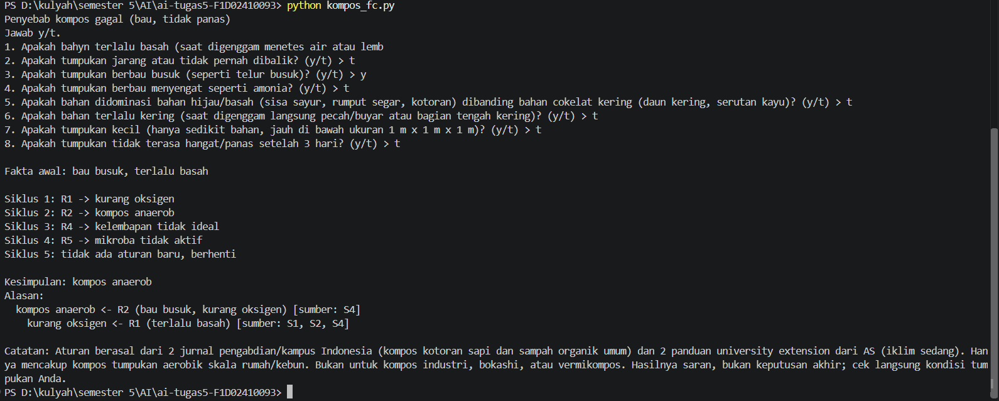
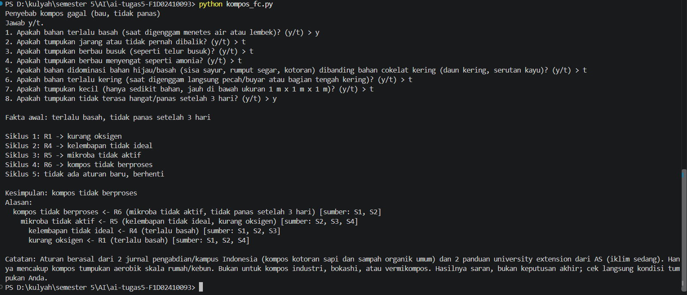
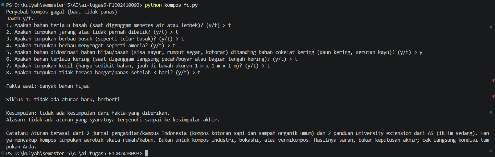

# Sistem Pakar Sederhana: Penyebab Kompos Gagal


- Nama: **Sabrina Salsabila**
- NIM: **F1D02410093**

## 1. Topik dan Cara Menjalankan

**Topik:** penyebab kompos gagal pada pengomposan tumpukan skala rumah/kebun (bau busuk, bau amonia, dan tumpukan yang tidak panas).

**Bahasa dan versi:** Python 3.8 atau lebih baru. Hanya memakai library standar (`json`, `sys`), tidak perlu instalasi tambahan.

**Struktur file:**

```
ai-tugas5-NIM/
├── kompos_fc.py      
├── kb_kompos.json     
├── README.md
├── Refrensi/
└── screenshot/       
```

**Cara menjalankan:**

```
python kompos_fc.py
```

Program menanyakan 8 fakta dasar (jawab `y` atau `t`), lalu menampilkan jejak inferensi, kesimpulan, alasan, dan catatan batas keberlakuan.

## 2. Sumber dan Tabel Aturan

### Daftar sumber

| Kode | Judul | Penerbit | URL | Tanggal akses |
|---|---|---|---|---|
| S1 | Pembuatan Pupuk Kompos Dari Limbah Kotoran Sapi Untuk Menambah Kesuburan Tanaman Holtikultura Dilahan Perkarangan Rumah Desa Genggelang, Kecamatan Gangga, Kabupaten Lombok Utara | Jurnal Pengabdian Magister Pendidikan IPA, Universitas Mataram, 2023, 6(3): 545-548 | https://jppipa.unram.ac.id/index.php/jpmpi/article/download/4818/3093/22771 | 10 November 2026 |
| S2 | Pemanfaatan Sampah Organik Sebagai Bahan Baku Pupuk Kompos dan Pengaruhnya Terhadap Tanaman dan Tanah (Inka Dahlianah) | Klorofil X-1, Juni 2015, Universitas PGRI Palembang | https://jurnal.um-palembang.ac.id/klorofil/article/download/190/162 | 10 November 2026 |
| S3 | Composting (HGIC 1600) | Clemson Cooperative Extension, Home & Garden Information Center, Clemson University, revisi 4 April 2024 | https://hgic.clemson.edu/factsheet/composting/ | 10 November 2026 |
| S4 | Make compost that really cooks: troubleshoot heat, odor and pests | Oregon State University Extension Service | https://extension.oregonstate.edu/news/make-compost-really-cooks-troubleshoot-heat-odor-pests | 10 November 2026 |

### Tabel aturan

Fakta dasar (ditanyakan ke user): bau busuk, bau amonia, terlalu basah, terlalu kering, jarang dibalik, banyak bahan hijau, tumpukan kecil, tidak panas setelah 3 hari.

| Aturan | IF | THEN | Sumber |
|---|---|---|---|
| R1 | terlalu basah **OR** jarang dibalik | kurang oksigen | S1, S2, S4 |
| R2 | bau busuk **AND** kurang oksigen | **kompos anaerob** | S4 |
| R3 | bau amonia **AND** banyak bahan hijau | **nitrogen berlebih** | S3 |
| R4 | terlalu basah **OR** terlalu kering | kelembapan tidak ideal | S1, S2, S3 |
| R5 | kelembapan tidak ideal **OR** tumpukan kecil **OR** kurang oksigen | mikroba tidak aktif | S2, S3, S4 |
| R6 | mikroba tidak aktif **AND** tidak panas setelah 3 hari | **kompos tidak berproses** | S1, S2 |

Ada 6 aturan dengan 3 kesimpulan akhir . Aturan memakai hasil aturan lain: R2 memakai hasil R1, R5 memakai hasil R1 dan R4, dan R6 memakai hasil R5. Aturan lengkap beserta sumbernya ada di `kb_kompos.json`.

**Catatan tentang dasar tiap aturan:**

- R1 (basah atau jarang dibalik → kurang oksigen): S4 menyebut bau telur busuk muncul karena oksigen rendah dan kelembapan berlebih, S1 menyebut pembalikan memasukkan udara segar, dan S2 menyebut kelembapan memengaruhi suplai oksigen.
- R2 (bau busuk dan kurang oksigen → kompos anaerob): S4 mengaitkan bau telur busuk dengan oksigen rendah dan kelembapan berlebih. S3 juga mencatat bau busuk muncul karena terlalu lembap dan bahan menggumpal.
- R3 (bau amonia dan bahan hijau banyak → nitrogen berlebih): S3 menyebut bau amonia disebabkan terlalu banyak potongan rumput atau sisa makanan, dan menjelaskan bahwa bila rasio C:N di bawah 30:1, kelebihan nitrogen dilepas sebagai gas amonia.
- R4 (terlalu basah atau kering → kelembapan tidak ideal): S1 menyebut uji genggam untuk kelembapan, dan S3 menyebut dekomposisi melambat bila kelembapan terlalu sedikit atau terlalu banyak.
- R5 (kelembapan tidak ideal, tumpukan kecil, atau kurang oksigen → mikroba tidak aktif): S3 dan S4 menyebut tumpukan yang terlalu kecil sulit mempertahankan panas, dan S3 menyebut mikroba butuh oksigen. Bagian "kelembapan tidak ideal atau kurang oksigen membuat mikroba tidak aktif" adalah penalaran saya berdasarkan S2 dan S3, bukan kalimat langsung dari satu sumber.
- R6 (tidak panas setelah 3 hari): batas 3 hari berasal dari S1, sedangkan S4 menyebut tumpukan yang dibangun dengan baik biasanya panas dalam seminggu, jadi batas waktunya tidak seragam antar sumber. S3 menyebut panas dihasilkan oleh dekomposisi mikroba.
- Ukuran minimum tumpukan berbeda antar sumber (S3: minimal sekitar 3 kaki kubik atau sekitar 0,08 meter kubik, S4: sekitar 0,5 sampai 1 yard kubik atau sekitar 0,4 sampai 0,75 meter kubik). Karena itu pertanyaan program memakai istilah "jauh di bawah ukuran 1 m x 1 m x 1 m", tanpa angka batas yang kaku.
- Angka rasio C/N tidak dimasukkan ke aturan. S3 menyebut rasio ideal 30:1, sedangkan S2 menyebut 30:1 sampai 40:1.

## 3. Metode yang Dipilih: Forward Chaining (FC)

Metode FC dipilih karena arah masalahnya dari gejala ke penyebab. Pemilik kompos biasanya hanya tahu gejala yang terlihat (bau, kelembapan, suhu), lalu ingin tahu penyebabnya. FC cocok karena mulai dari fakta yang dijawab user, menjalankan aturan yang cocok, dan menambahkan hasilnya ke memori sampai tidak ada aturan baru. Bentuk aturannya juga mudah dihubungkan menjadi rantai (misalnya R1 → R5 → R6).

Cara kerja mesin (ditulis sendiri di `kompos_fc.py`):

```
memori <- fakta yang dijawab "ya" oleh user
ULANGI:
    cocok <- aturan yang syaratnya terpenuhi oleh memori DAN hasilnya belum ada di memori
    JIKA cocok kosong: BERHENTI
    r <- cocok[0]
    tambahkan r.maka ke memori
    catat bahwa r.maka berasal dari r
```

Syarat terpenuhi: mode `dan` berarti semua syarat ada di memori, mode `atau` berarti salah satu ada. Aturan yang hasilnya sudah ada di memori tidak dijalankan lagi, sehingga program tidak berputar terus.

## 4. Kasus Uji dan Screenshot

| # | Jawaban "ya" | Kesimpulan yang diharapkan |
|---|---|---|
| 1 | terlalu basah, bau busuk | kompos anaerob |
| 2 | terlalu basah, tidak panas setelah 3 hari | kompos tidak berproses |
| 3 | banyak bahan hijau saja | tidak ada (kasus negatif) |

### Kasus 1: kompos anaerob



### Kasus 2: kompos tidak berproses (rantai R1/R4 → R5 → R6)



### Kasus 3: tidak ada kesimpulan



## 5. Batas Keberlakuan

Pengetahuan dalam program ini berasal dari dua jurnal pengabdian/kampus Indonesia (kompos kotoran sapi dan sampah organik umum) serta dua panduan university extension dari Amerika Serikat yang beriklim sedang, sehingga sebagian aturan (misalnya R2, R3, dan R5) belum tentu pas dengan kondisi tropis. Aturan hanya mencakup kompos tumpukan aerobik skala rumah atau kebun, dan tidak berlaku untuk kompos industri, bokashi, atau vermikompos. Hasilnya berupa saran, bukan keputusan akhir. Kondisi tumpukan yang sebenarnya tetap perlu dicek langsung. 
## 6. Penggunaan Alat Bantu AI

Saya memakai Claude sebagai alat bantu untuk brainstorming topik lalu notebooklm sebagai alat bantu untuk mencari jurnal yang berkaitan dengan topik
